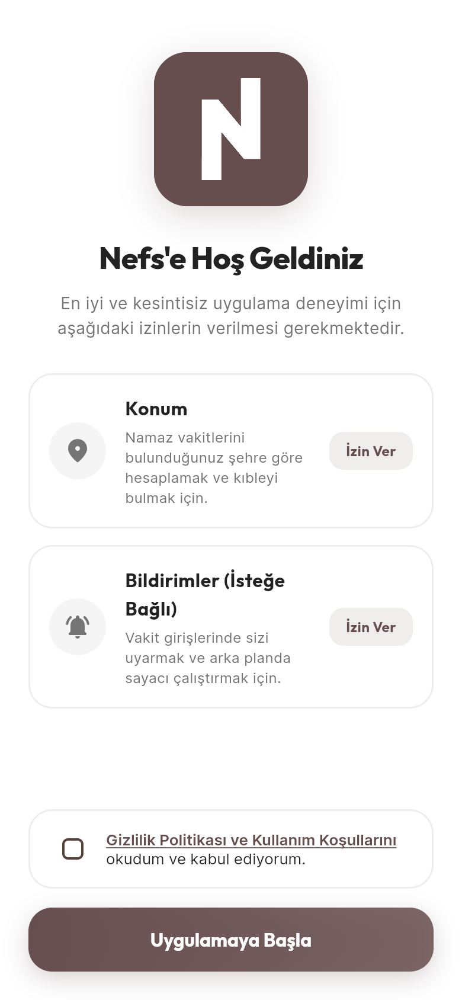
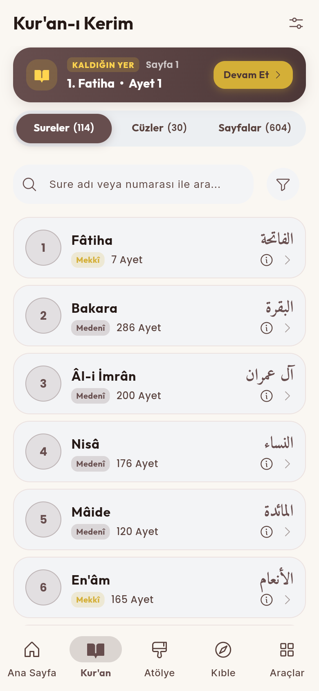
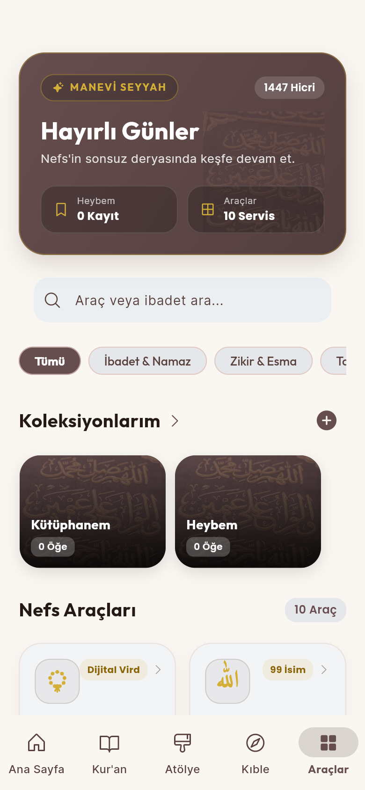

<p align="center"><a href="https://oidioom.com"></a></p>

<h1 align="center">🕌 Nefs</h1>

<p align="center"><b>A premium, ad-free Islamic lifestyle & spiritual guidance app.</b></p>

<p align="center">
  
  
  
  
  
  
  <a href="https://oidioom.com"></a>
</p>

<p align="center"><a href="#-english">🇬🇧 English</a> · <a href="#-türkçe">🇹🇷 Türkçe</a></p>

---

## 🇬🇧 English

Nefs brings everything a Muslim needs in daily life into one calm, minimal interface: accurate prayer times, the Holy Qur'an with translations and audio, a precise Qibla compass and many everyday tools — Turkish-first and multilingual.

> [!NOTE]
> This is a **showcase repository**. Nefs is closed-source; this repo contains the project overview, screenshots and a few short code excerpts.

## ✨ Features

- 🕰️ Prayer times (Diyanet & other methods) with live countdown and notifications
- 📖 Qur'an with translations in many languages, tafsir and audio recitation
- 🧭 High-precision Qibla compass (spherical trigonometry + magnetic declination)
- 📿 Zikirmatik & Esma-ül Hüsna
- 🧮 Zakat calculator with live currency rates, missed-prayer (kaza) tracker
- 🗓️ Hijri calendar, Friday sermons, nearby mosques
- 🎨 Atelier: personal themes and collections

## 📸 Screenshots

<table>
<tr><td align="center"><br><sub>Welcome</sub></td><td align="center"><br><sub>Qur'an</sub></td><td align="center"><br><sub>Tools</sub></td></tr>
</table>

## 🧩 Code Showcase

A few real, short excerpts from the codebase — each with a note on what it does and where it is used. See the [`showcase/`](showcase) folder.

**[`qibla_bearing.dart`](showcase/qibla_bearing.dart)** — Calculates the true Qibla bearing from the user's location using spherical trigonometry. _Used by the Qibla compass screen (features/qibla)._

```dart
static double calculateTrueBearing(double userLat, double userLng) {
  final phi1 = _toRadians(userLat), phi2 = _toRadians(kaabaLat);
  final deltaL = _toRadians(kaabaLng) - _toRadians(userLng);
  final y = sin(deltaL);
  final x = cos(phi1) * tan(phi2) - sin(phi1) * cos(deltaL);
  return (_toDegrees(atan2(y, x)) + 360) % 360;
}
```

**[`qibla_distance.dart`](showcase/qibla_distance.dart)** — Haversine distance (km) between the user and the Kaaba. _Shown under the compass as 'distance to Kaaba'._

```dart
const double R = 6371.0;
final dLat = _toRadians(kaabaLat - userLat);
final dLon = _toRadians(kaabaLng - userLng);
final a = sin(dLat / 2) * sin(dLat / 2) +
    cos(_toRadians(userLat)) * cos(_toRadians(kaabaLat)) * sin(dLon / 2) * sin(dLon / 2);
return R * 2 * atan2(sqrt(a), sqrt(1 - a));
```

## 🛠️ Built With

Flutter · Dart · Provider · go_router · sqflite · just_audio · geolocator · flutter_compass

## 📄 License

© 2026 Oidioom / Tarek Sharabaty. All rights reserved. See [LICENSE](LICENSE).

---

## 🇹🇷 Türkçe

**Reklamsız, sade ve premium bir İslami yaşam ve manevi rehberlik uygulaması.**

Nefs, bir Müslümanın günlük hayatta ihtiyaç duyduğu her şeyi sakin ve sade bir arayüzde toplar: doğru namaz vakitleri, meal ve sesli dinleme ile Kur'an-ı Kerim, hassas kıble pusulası ve birçok günlük araç. Türkçe öncelikli ve çok dillidir.

> [!NOTE]
> Bu bir **vitrin (showcase) deposudur**. Nefs kapalı kaynaklıdır; bu depoda proje tanıtımı, ekran görüntüleri ve birkaç kısa kod alıntısı bulunur.

## ✨ Özellikler

- 🕰️ Canlı geri sayım ve bildirimli namaz vakitleri (Diyanet ve diğer yöntemler)
- 📖 Çok dilli meal, tefsir ve sesli tilavet ile Kur'an-ı Kerim
- 🧭 Yüksek hassasiyetli kıble pusulası (küresel trigonometri + manyetik sapma)
- 📿 Zikirmatik ve Esma-ül Hüsna
- 🧮 Canlı kurlarla zekât hesaplayıcı, kaza namazı takibi
- 🗓️ Hicri takvim, Cuma hutbeleri, yakındaki camiler
- 🎨 Atölye: kişisel temalar ve koleksiyonlar

## 🧩 Kod Vitrini

Kod tabanından kısa ve gerçek alıntılar; kodlar yukarıdaki İngilizce bölümde gösterilmiştir. Hepsi [`showcase/`](showcase) klasöründe:

- **[`qibla_bearing.dart`](showcase/qibla_bearing.dart)** — Kullanıcının konumundan Kabe yönünü küresel trigonometri ile hesaplar. _Kıble pusulası ekranında kullanılır (features/qibla)._

- **[`qibla_distance.dart`](showcase/qibla_distance.dart)** — Kullanıcı ile Kabe arasındaki mesafeyi (km) Haversine formülüyle hesaplar. _Pusulanın altında 'Kabe'ye uzaklık' olarak gösterilir._

## 🛠️ Kullanılan Teknolojiler

Flutter · Dart · Provider · go_router · sqflite · just_audio · geolocator · flutter_compass

## 📄 Lisans

© 2026 Oidioom / Tarek Sharabaty. Tüm hakları saklıdır. Ayrıntılar için [LICENSE](LICENSE).

---

<p align="center"><a href="https://oidioom.com"></a></p>
<p align="center"><b>by Oidioom — Tarek Sharabaty</b><br>
<a href="https://oidioom.com">oidioom.com</a> · <a href="https://github.com/tariksharabaty">GitHub</a> · <a href="https://modrinth.com/organization/oidioomstudio">Modrinth</a> · <a href="https://gear.oidioom.com">Gear</a> · <a href="https://www.instagram.com/oidioom">Instagram</a></p>
